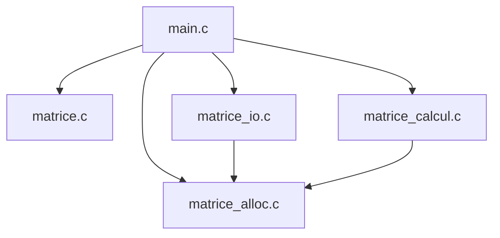
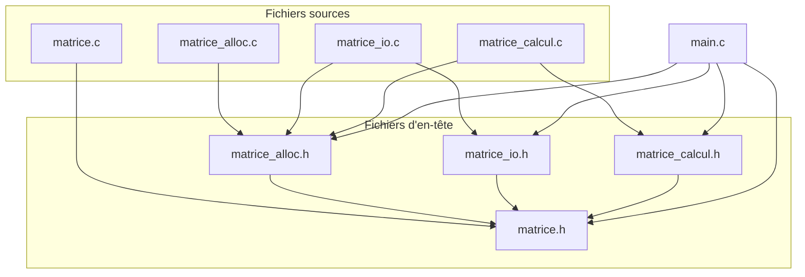

# TD Stockage de matrices en C

| Membre | GitHub |
|---|---|
| ID-BARKACH Youness | [@Centulus](https://github.com/Centulus) |
| NGO Phan Viet Quang | [@VietQuang1595](https://github.com/VietQuang1595) |
| KOUAME Melvine | [@NwarrDesir](https://github.com/NwarrDesir) |

Groupe de TD : TD2 (Matrices-G14) · 3e année STI, INSA Centre Val de Loire · Programmation C (A. Adell) · Remise : 2 novembre 2026

## Table des matières
1. [Introduction](#1-introduction)
2. [Conception](#2-conception)
3. [Exercice 1 : allocation et destruction](#3-exercice-1--allocation-et-destruction)
4. [Exercice 2 : entrées-sorties](#4-exercice-2--entrées-sorties)
5. [Exercice 3 : calcul matriciel](#5-exercice-3--calcul-matriciel)
6. [Exercice 4 : démonstration complète](#6-exercice-4--démonstration-complète)
7. [Vérifications mémoire](#7-vérifications-mémoire)
8. [Démonstration finale](#8-démonstration-finale)
9. [Bilan et difficultés](#9-bilan-et-difficultés)

---

## 1. Introduction
Dans ce TD de programmation en C, nous avons pour objectif de réaliser une bibliothèque permettant de stocker et de manipuler des matrices d'entiers de tailles différentes.

Le programme doit permettre de créer et de supprimer des matrices en utilisant l'allocation dynamique, de les lire et de les enregistrer dans des fichiers texte, ainsi que d'effectuer des additions et des multiplications matricielles.

Pour cela, nous avons séparé le programme en plusieurs modules, chacun chargé d'une partie du travail : la gestion de la mémoire, les entrées-sorties et les calculs. Cette organisation permet de travailler sur les différentes fonctions séparément, puis de les réunir dans un programme principal.

Ce TD nous permet aussi de travailler sur plusieurs notions vues en cours, notamment les pointeurs, les structures, la compilation séparée et la gestion des fichiers en C. Une attention particulière est portée à la gestion des erreurs et à la libération de la mémoire, afin d'éviter les fuites mémoire.

Enfin, nous utilisons les programmes de test fournis et quelques fichiers de test supplémentaires pour vérifier le comportement des fonctions, y compris lorsque les données sont incorrectes.
<!-- Ce qui fonctionne à la remise (dire honnêtement ce qui manque). -->

## 2. Conception
Pour ce projet, nous avons suivi l'organisation en modules définie dans le sujet. Le programme est réparti en plusieurs fichiers `.c` et `.h`, chacun ayant un rôle précis. Cette organisation permet de séparer les différentes fonctionnalités du programme, comme la gestion de la mémoire, les entrées-sorties et les calculs matriciels.

Chaque module possède un fichier d'en-tête `.h`, qui contient les déclarations nécessaires à son utilisation, et un fichier `.c`, dans lequel les fonctions sont implémentées. Les modules peuvent ainsi être compilés séparément, puis réunis pour former le programme final.

Pour représenter les matrices, nous utilisons la structure `Matrice`, composée de deux entiers indiquant le nombre de lignes et de colonnes, ainsi que d'un double pointeur `int **coef` permettant d'accéder aux coefficients. Cette représentation nécessite une allocation dynamique de la mémoire, puisque les dimensions des matrices ne sont pas connues à l'avance.

Enfin, le sujet définit plusieurs règles concernant la gestion de la mémoire, les paramètres des fonctions et les erreurs possibles. Ces règles doivent être respectées dans tous les modules pour assurer leur bon fonctionnement ensemble et éviter les problèmes comme les fuites mémoire ou les doubles libérations.

### 2.1 Schéma des modules
Le programme est organisé en quatre modules, auxquels s'ajoute le fichier principal `main.c`. Chaque module s'occupe d'une partie précise du programme, ce qui permet de séparer les fonctions selon leur rôle.

| Module             | Rôle                                                        |
|--------------------|-------------------------------------------------------------|
|  matrice.c         | Vérifie les matrices et fournit les messages d'erreur.      |
|  matrice_alloc.c   | Gère l'allocation et la libération de la mémoire.           |
|  matrice_io.c      | Permet de lire, d'écrire et d'afficher les matrices.        |
|  matrice_calcul.c  | Effectue l'addition et la multiplication des matrices.      |
|  main.c            | Utilise les modules pour exécuter le programme principal.   |

Le schéma suivant présente l'organisation générale du programme :



Le programme principal commence par charger deux matrices depuis des fichiers texte à l'aide du module `matrice_io`. Il appelle ensuite les fonctions de `matrice_calcul` pour effectuer l'opération demandée. Le résultat est affiché, puis enregistré dans un fichier.

Les modules `matrice_io` et `matrice_calcul` utilisent également les fonctions de `matrice_alloc` pour créer et détruire les matrices nécessaires aux opérations.

### 2.2 Graphe des inclusions

Chaque fichier `.c` inclut son propre fichier d'en-tête `.h`, qui contient les déclarations des fonctions utilisées. Certains modules incluent aussi d'autres en-têtes lorsqu'ils ont besoin de leurs fonctions ou de leurs types.

Le graphe suivant représente les principales inclusions entre les fichiers du projet. Une flèche signifie que le fichier de départ inclut le fichier d'arrivée avec `#include`.





Par exemple, `matrice_io.c` inclut `matrice_alloc.h` car la fonction `mat_lire` a besoin de `mat_allouer` pour créer une matrice, puis de `mat_detruire` en cas d'erreur. De même, `matrice_calcul.c` utilise ces fonctions pour gérer la mémoire des matrices résultats.

Les fichiers d'en-tête utilisent également des gardes d'inclusion pour éviter qu'un même fichier soit inclus plusieurs fois lors de la compilation.

Par exemple, dans `matrice_io.h` :

```c
#ifndef MATRICE_IO_H
#define MATRICE_IO_H

/* Déclarations du module */

#endif
```

La directive `#ifndef` vérifie si `MATRICE_IO_H` n'a pas encore été définie. Si c'est le cas, `#define` la définit et le contenu du fichier est pris en compte. Lors d'une nouvelle inclusion, ce contenu est ignoré, ce qui évite notamment les erreurs de redéfinition.


### 2.3 Règles de propriété de la mémoire (R1 à R7)

Comme les matrices sont allouées dynamiquement, il faut définir qui est responsable de leur mémoire. Le sujet impose sept règles communes à tous les modules pour éviter les fuites mémoire et les doubles libérations.

**R1—Initialisation :** Toute variable de type `Matrice` doit être initialisée à `MATRICE_VIDE`. Cela permet de commencer avec une matrice qui ne possède aucune mémoire allouée.

**R2—Propriété du résultat :** Lorsqu'une fonction crée une matrice avec succès (`MAT_OK`), c'est le code appelant qui devient responsable de sa mémoire. Il doit donc appeler `mat_detruire` lorsqu'il n'en a plus besoin.

**R3—Gestion des échecs :** Si une fonction échoue, elle doit libérer toute la mémoire qu'elle a allouée et laisser son résultat à `MATRICE_VIDE`. L'appelant n'a alors aucune mémoire à libérer pour ce résultat.

**R4—Matrices d'entrée :** Une fonction ne doit jamais modifier ni libérer les matrices reçues en entrée (`const Matrice *`). Elle doit conserver leurs données intactes.

**R5—Paramètre de sortie :** Le paramètre `res` sert à stocker le résultat d'une opération. Son ancien contenu est écrasé : s'il possède déjà de la mémoire, l'appelant doit la libérer avant l'appel. `res` doit également être différent des matrices d'entrée.

**R6—Destruction :** La fonction `mat_detruire` libère la mémoire d'une matrice et la remet à `MATRICE_VIDE`. On peut donc l'appeler plusieurs fois sur la même variable sans provoquer de double libération.

**R7—Gestion des fichiers :** Le code qui ouvre un fichier avec `fopen` doit aussi le fermer avec `fclose`. Les fonctions de `matrice_io.c` reçoivent des fichiers déjà ouverts et ne les ferment pas elles-mêmes.

Ces règles sont notamment utilisées dans `main.c`. Les matrices `a`, `b` et `r` sont initialisées à `MATRICE_VIDE`, puis libérées à la fin du programme, même si une erreur survient pendant la lecture, le calcul ou l'enregistrement.


### 2.4 Choix de réalisation

Plusieurs choix techniques sont définis dans le sujet pour assurer le bon fonctionnement des modules et gérer les erreurs.

**Fonctions internes (`static`)**

Certaines fonctions sont déclarées avec le mot-clé `static`, comme `lire_entier` dans `matrice_io.c` et `verifier_parametres` dans `matrice_calcul.c`. Elles sont utilisées uniquement à l'intérieur de leur fichier `.c` et ne sont donc pas accessibles depuis les autres modules.

Cela permet de garder les fonctions internes séparées des fonctions publiques déclarées dans les fichiers `.h`.

**Gestion des échecs d'allocation**

Une matrice est représentée par un tableau de pointeurs `int **coef`. Le programme alloue d'abord le tableau des pointeurs, puis chaque ligne séparément avec `mat_calloc`.

Si une allocation échoue au milieu de cette opération, les lignes déjà allouées sont libérées avec `free`, puis le tableau des pointeurs est également libéré. La fonction renvoie alors `MAT_ERR_ALLOCATION` et laisse la matrice résultat vide.

Cette vérification est importante pour éviter les fuites mémoire lorsqu'une matrice ne peut pas être entièrement créée.

**Détection des dépassements d'entiers**

Lors de l'addition et de la multiplication, le résultat d'un calcul peut dépasser les limites du type `int`.

Pour éviter ce problème, les calculs sont effectués dans un type plus grand, `long long`. Le programme vérifie ensuite que les valeurs obtenues sont comprises entre `INT_MIN` et `INT_MAX`.

Pour la multiplication matricielle, chaque addition à la somme des produits est également vérifiée afin d'éviter un dépassement de `long long`.

Si un dépassement est détecté, la fonction libère la matrice résultat et renvoie `MAT_ERR_DEPASSEMENT`.


### 2.5 Compilation

Le projet utilise la compilation séparée : chaque fichier `.c` peut être compilé indépendamment en un fichier objet `.o`. Ces fichiers sont ensuite réunis lors de l'édition de liens pour créer l'exécutable final.

Pour compiler directement le programme de démonstration, on peut utiliser la commande suivante :

```bash
gcc -std=c11 -Wall -Wextra -Wpedantic -g \
    main.c matrice.c matrice_alloc.c matrice_io.c matrice_calcul.c \
    -o demo_matrices
```

Les options `-Wall`, `-Wextra` et `-Wpedantic` permettent d'activer les avertissements du compilateur. L'option `-g` ajoute les informations nécessaires au débogage.

Une fois la compilation terminée, le programme peut être exécuté avec la commande suivante :

```bash
./demo_matrices add donnees/A.txt donnees/B.txt R.txt
```

Cette commande lit les matrices A et B, effectue leur addition et enregistre le résultat dans `R.txt`.

Les programmes `test_ex1`, `test_ex2` et `test_ex3` permettent également de vérifier séparément les différentes fonctions de la bibliothèque.


## 3. Exercice 1 : allocation et destruction
<!-- Youness : code commenté des parties À COMPLÉTER (1.a à 1.f), uniquement ce qu'on a écrit. -->

### Questions

### Questions

**Q3.1 — Pourquoi mat_detruire prend-elle un Matrice * et non un Matrice ? Que se passerait-il avec un passage par valeur ?**

La fonction `mat_detruire` reçoit un pointeur `Matrice *` pour pouvoir modifier directement la matrice de l'appelant. Après avoir libéré la mémoire, elle remet ses champs à l'état `MATRICE_VIDE`.

Avec un passage par valeur, la fonction travaillerait sur une copie de la structure. La mémoire pointée pourrait être libérée, mais la matrice d'origine garderait un pointeur vers une zone déjà libérée. Cela pourrait provoquer des erreurs si on essayait de la réutiliser ou de la détruire une deuxième fois.

**Q3.2 — Combien d'appels à calloc et à free faut-il pour une matrice n × p ? Si la k-ième allocation échoue, combien de libérations faut-il effectuer ?**

Pour une matrice de `n` lignes et `p` colonnes, il faut `1 + n` allocations : une pour le tableau des pointeurs et une pour chacune des `n` lignes.

La destruction complète nécessite donc également `1 + n` appels à `free`.

Si la k-ième allocation échoue, les `k - 1` allocations précédentes ont réussi. Il faut alors effectuer `k - 1` appels à `free` pour libérer toute la mémoire déjà réservée.

**Q3.3 — Pourquoi peut-on appeler mat_detruire deux fois sans danger ? Est-ce toujours vrai avec une copie de la matrice ?**

Après le premier appel, `mat_detruire` remet la matrice à `MATRICE_VIDE`. Lors du deuxième appel, le pointeur `coef` vaut `NULL`, donc aucune mémoire n'est libérée une seconde fois.

En revanche, si on écrit `Matrice b = a;`, les deux structures contiennent le même pointeur `coef`. Ce n'est pas une copie des coefficients, mais seulement de leur adresse. Si on détruit `a`, la mémoire est libérée, mais `b` pointe toujours vers cette même zone. Appeler ensuite `mat_detruire(&b)` peut donc provoquer une double libération.

**Q3.4 — Pourquoi mat_allouer initialise-t-elle *res à MATRICE_VIDE avant de vérifier les dimensions ?**

La fonction initialise `*res` à `MATRICE_VIDE` dès le début pour garantir que le résultat reste vide en cas d'erreur. Ainsi, si les dimensions sont invalides ou si une allocation échoue, l'appelant ne reçoit pas une matrice partiellement construite. Cela permet de respecter la règle R3 et de simplifier la gestion des erreurs.


### Résultat du test
```text
(sortie de ./test_ex1, avec la ligne Bilan : 16 / 16)
```

## 4. Exercice 2 : entrées-sorties
<!-- Melvine : code commenté 2.a à 2.f -->

### Questions
**Q4.1** …

**Q4.2** …

**Q4.3** …

**Q4.4** …

### Résultat du test
```text
(sortie de ./test_ex2, Bilan : 14 / 14)
```

## 5. Exercice 3 : calcul matriciel
<!-- Youness : code commenté 3.a à 3.h -->

### Questions
**Q5.1** …

**Q5.2** …

**Q5.3** …

**Q5.4** …

### Résultat du test
```text
(sortie de ./test_ex3, Bilan : 14 / 14)
```

## 6. Exercice 4 : démonstration complète

Dans cet exercice, nous avons complété le fichier `main.c` pour utiliser les fonctions des différents modules dans un même programme. Le programme reçoit quatre arguments : l'opération à effectuer (`add` ou `mul`), les chemins des deux fichiers contenant les matrices A et B, et le chemin du fichier où enregistrer le résultat.

Les fonctions `charger` et `sauvegarder` étaient déjà fournies dans le sujet. Notre travail consistait à compléter les étapes 4.a à 4.d.

**4.a — Affichage des matrices**

Après la lecture des deux fichiers, nous affichons les matrices A et B avec `mat_afficher`.

```c
mat_afficher("A", &a);
mat_afficher("B", &b);
```

**4.b — Calcul du résultat**

Selon l'opération choisie, le programme appelle `mat_additionner` ou `mat_multiplier`. Nous utilisons l'opérateur ternaire proposé dans le sujet.

```c
MatErreur err = addition ? mat_additionner(&a, &b, &r)
                         : mat_multiplier(&a, &b, &r);
```

Si le calcul échoue, le programme affiche un message d'erreur ainsi que les dimensions des matrices, puis passe directement au nettoyage avec `goto nettoyage`. Cela permet de gérer les cas comme les dimensions incompatibles ou les dépassements d'entiers.

**4.c — Affichage du résultat**

Lorsque le calcul réussit, nous affichons la matrice résultat en précisant l'opération effectuée.

```c
mat_afficher(addition ? "R = A + B" : "R = A x B", &r);
```

**4.d — Confirmation de l'enregistrement**

Après l'enregistrement du résultat dans le fichier de sortie, nous affichons un message de confirmation et indiquons que le programme s'est terminé correctement.

```c
printf("Résultat enregistré dans \"%s\".\n", argv[4]);
statut = EXIT_SUCCESS;
```

Enfin, le programme passe par l'étiquette `nettoyage`, où les trois matrices sont libérées avec `mat_detruire`. Ce nettoyage est effectué aussi bien en cas de succès qu'en cas d'erreur.

### Questions

**Q6.1 — Pourquoi le message d'erreur est-il affiché dans main.c et non dans mat_lire ?**

La fonction `mat_lire` fait partie de la bibliothèque. Son rôle est de lire une matrice et de renvoyer un code d'erreur si nécessaire, sans décider comment cette erreur doit être affichée. C'est donc le programme appelant, ici `main.c`, qui affiche le message correspondant avec `mat_message_erreur`.

Cela permet de réutiliser la bibliothèque dans d'autres programmes, par exemple une application graphique qui afficherait les erreurs dans une fenêtre plutôt que dans un terminal.

**Q6.2 — Pourquoi le résultat de fclose est-il testé dans sauvegarder mais pas dans charger ?**

Dans `sauvegarder`, le fichier est ouvert en écriture. Certaines erreurs peuvent apparaître seulement au moment de `fclose`, lorsque les dernières données sont écrites sur le disque. Il faut donc vérifier son résultat pour détecter un éventuel échec d'enregistrement. Dans `charger`, le fichier est ouvert en lecture. Les erreurs de lecture sont déjà détectées par `mat_lire`, et la fermeture ne nécessite pas d'écriture de données. C'est pourquoi le code fourni ne vérifie pas le résultat de `fclose` dans cette fonction.

**Q6.3 — Dans le scénario 8, combien de matrices faut-il libérer si l'enregistrement échoue après un calcul réussi ?**

Il faut libérer les trois matrices : A, B et R. Même si l'enregistrement a échoué, les deux matrices d'entrée ont été chargées et la matrice résultat a été créée pendant le calcul. Le programme utilise `goto nettoyage` pour rejoindre la partie qui appelle `mat_detruire` sur les trois matrices. Ainsi, toute la mémoire allouée est libérée avant de quitter le programme.


## 7. Vérifications mémoire
<!-- Melvine : pour test_ex1, test_ex2, test_ex3 et demo_matrices, le HEAP SUMMARY de valgrind --leak-check=full -->
<!-- + un scénario d'erreur de demo_matrices sous valgrind. -->

### test_ex1
```text
HEAP SUMMARY: ...
All heap blocks were freed -- no leaks are possible
```

### test_ex2
```text
```

### test_ex3
```text
```

### demo_matrices (calcul réussi)
```text
```

### demo_matrices (scénario d'erreur)
```text
```

## 8. Démonstration finale

Pour vérifier le fonctionnement du programme complet, nous avons prévu plusieurs scénarios de test. Ils permettent de contrôler l'addition, la multiplication et la gestion des erreurs.

### Scénario 1 : addition de deux matrices

Commande :

```bash
./demo_matrices add donnees/A.txt donnees/B.txt R.txt
echo $?
```

Sortie du programme :

```text
(À compléter)
```

Résultat attendu : code de sortie `0`. Le programme doit afficher les matrices A et B, calculer leur somme et enregistrer le résultat dans `R.txt`.

### Scénario 2 : multiplication de deux matrices

Commande :

```bash
./demo_matrices mul donnees/A.txt donnees/C.txt R.txt
echo $?
```

Sortie du programme :

```text
(À compléter)
```

Résultat attendu : code de sortie `0`. Le programme doit calculer le produit de A par C, qui donne une matrice de dimensions 4 × 2.

### Scénario 3 : addition avec dimensions incompatibles

Commande :

```bash
./demo_matrices add donnees/A.txt donnees/C.txt R.txt
echo $?
```

Sortie du programme :

```text
(À compléter)
```

Résultat attendu : code de sortie `1`. Les matrices A et C n'ont pas les mêmes dimensions, donc l'addition est impossible. Le programme doit afficher un message d'erreur et ne pas créer de nouveau fichier résultat.

Dans les trois scénarios, les matrices doivent être libérées avant la fin du programme, y compris lorsqu'une erreur survient.


### Scénario 4 : addition de matrices 1 × 1

Commande :

```bash
./demo_matrices add donnees/test_1x1_a.txt donnees/test_1x1_b.txt R.txt
echo $?
```

Sortie du programme :

```text
(À compléter )
```

Résultat attendu : code de sortie `0`. Les deux matrices ne contiennent qu'un seul coefficient, respectivement 5 et 3. Le résultat doit donc être une matrice 1 × 1 contenant la valeur 8.

### Scénario 5 : multiplication avec des coefficients négatifs

Commande :

```bash
./demo_matrices mul donnees/test_negatif_a.txt donnees/test_negatif_b.txt R.txt
echo $?
```

Sortie du programme :

```text
(À compléter)
```

Résultat attendu : code de sortie `0`. Ce test permet de vérifier que la multiplication fonctionne également avec des coefficients négatifs.

Le résultat attendu est :

```text
2 2
-17 54
30 -68
```

### Scénario 6 : lecture d'un fichier incorrect

Commande :

```bash
./demo_matrices add donnees/test_non_numerique.txt donnees/B.txt R.txt
echo $?
```

Sortie du programme :

```text
(À compléter)
```

Résultat attendu : code de sortie `1`. Le fichier contient une valeur non numérique (`abc`) à la place d'un coefficient. La fonction `mat_lire` doit détecter cette erreur et renvoyer `MAT_ERR_FORMAT`.

Le programme doit alors afficher un message d'erreur et s'arrêter sans effectuer le calcul.


## 9. Bilan et difficultés

### Ce que nous avons compris / difficultés rencontrées

Ce TD nous a permis de mieux comprendre la programmation modulaire en C, notamment la séparation entre les fichiers d'en-tête `.h` et les fichiers sources `.c`. Nous avons également travaillé sur l'allocation dynamique, la manipulation des pointeurs et la gestion des fichiers texte.

L'un des aspects les plus difficles du projet concerne la gestion de la mémoire. Comme les lignes d'une matrice sont allouées séparément, il faut prévoir le cas où une allocation échoue avant que la matrice soit entièrement créée. Dans ce cas, toutes les zones déjà allouées doivent être libérées pour éviter les fuites mémoire. La gestion des erreurs constitue également un point important. Chaque fonction doit renvoyer le bon code d'erreur tout en respectant les règles définies dans le sujet. Il faut notamment distinguer les erreurs liées aux arguments, aux dimensions des matrices et au contenu des fichiers.

Enfin, les opérations matricielles nécessitent quelques précautions, notamment pour vérifier la compatibilité des dimensions et éviter les dépassements d'entiers lors des calculs. Ce projet nous a ainsi permis de mieux comprendre l'importance des vérifications et de la gestion de la mémoire dans un programme C composé de plusieurs modules.


### Répartition du travail
- **Youness ID-BARKACH** : …
- **Melvine KOUAME** : …
- **Quang NGO** : …

### Aides extérieures
<!-- Obligatoire : toute ressource (forum, IA…) doit être déclarée avec son usage. -->