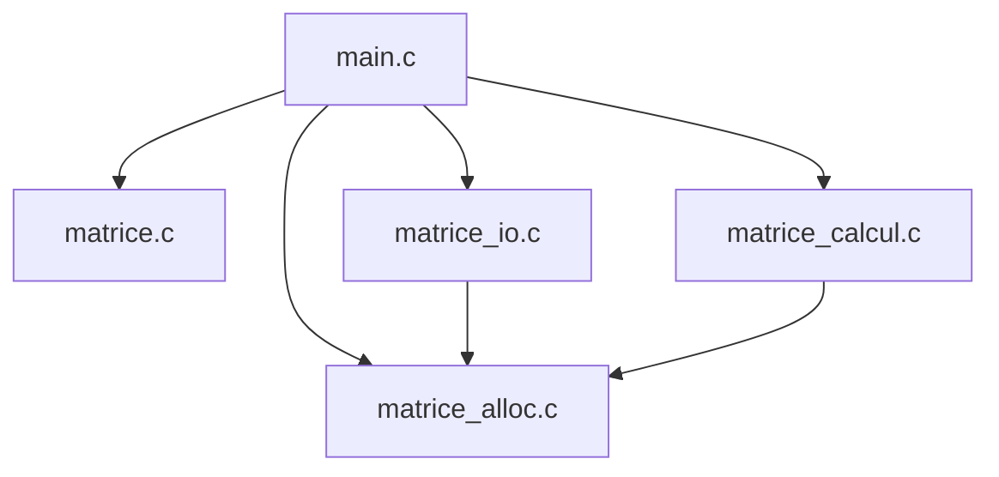
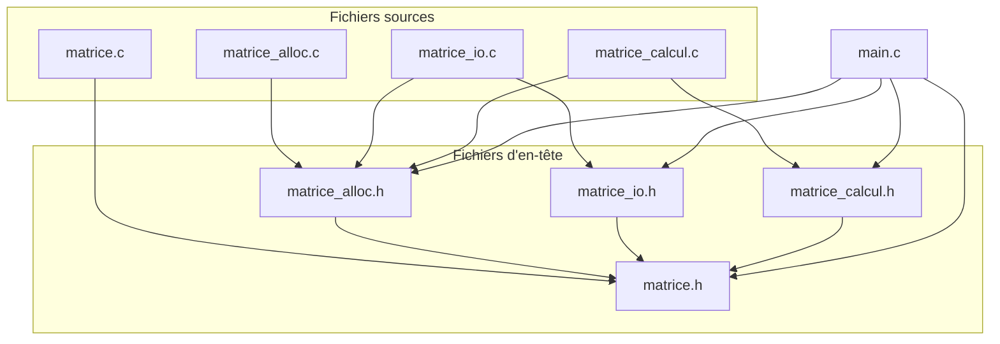

# TD Stockage de matrices en C

| Membre | GitHub |
|---|---|
| ID-BARKACH Youness | [@Centulus](https://github.com/Centulus) |
| NGO Phan Viet Quang | [@VietQuang1595](https://github.com/VietQuang1595) |
| KOUAME Melvine | [@NwarrDesir](https://github.com/NwarrDesir) |

Groupe de TD : TD2 (Matrices-G14) · 3e année STI, INSA Centre Val de Loire · Programmation C (A. Adell) · Remise : 2 novembre 2026

## Table des matières
1. [Introduction](#1-introduction)
2. [Conception](#2-conception)
3. [Exercice 1 : allocation et destruction](#3-exercice-1--allocation-et-destruction)
4. [Exercice 2 : entrées-sorties](#4-exercice-2--entrées-sorties)
5. [Exercice 3 : calcul matriciel](#5-exercice-3--calcul-matriciel)
6. [Exercice 4 : démonstration complète](#6-exercice-4--démonstration-complète)
7. [Vérifications mémoire](#7-vérifications-mémoire)
8. [Démonstration finale](#8-démonstration-finale)
9. [Bilan et difficultés](#9-bilan-et-difficultés)

---

## 1. Introduction
Dans ce TD de programmation en C, nous avons pour objectif de réaliser une bibliothèque permettant de stocker et de manipuler des matrices d'entiers de tailles différentes.

Le programme doit permettre de créer et de supprimer des matrices en utilisant l'allocation dynamique, de les lire et de les enregistrer dans des fichiers texte, ainsi que d'effectuer des additions et des multiplications matricielles.

Pour cela, nous avons séparé le programme en plusieurs modules, chacun chargé d'une partie du travail : la gestion de la mémoire, les entrées-sorties et les calculs. Cette organisation permet de travailler sur les différentes fonctions séparément, puis de les réunir dans un programme principal.

Ce TD nous permet aussi de travailler sur plusieurs notions vues en cours, notamment les pointeurs, les structures, la compilation séparée et la gestion des fichiers en C. Une attention particulière est portée à la gestion des erreurs et à la libération de la mémoire, afin d'éviter les fuites mémoire.

Enfin, nous utilisons les programmes de test fournis et quelques fichiers de test supplémentaires pour vérifier le comportement des fonctions, y compris lorsque les données sont incorrectes.
<!-- Ce qui fonctionne à la remise (dire honnêtement ce qui manque). -->

## 2. Conception
Pour ce projet, nous avons suivi l'organisation en modules définie dans le sujet. Le programme est réparti en plusieurs fichiers `.c` et `.h`, chacun ayant un rôle précis. Cette organisation permet de séparer les différentes fonctionnalités du programme, comme la gestion de la mémoire, les entrées-sorties et les calculs matriciels.

Chaque module possède un fichier d'en-tête `.h`, qui contient les déclarations nécessaires à son utilisation, et un fichier `.c`, dans lequel les fonctions sont implémentées. Les modules peuvent ainsi être compilés séparément, puis réunis pour former le programme final.

Pour représenter les matrices, nous utilisons la structure `Matrice`, composée de deux entiers indiquant le nombre de lignes et de colonnes, ainsi que d'un double pointeur `int **coef` permettant d'accéder aux coefficients. Cette représentation nécessite une allocation dynamique de la mémoire, puisque les dimensions des matrices ne sont pas connues à l'avance.

Enfin, le sujet définit plusieurs règles concernant la gestion de la mémoire, les paramètres des fonctions et les erreurs possibles. Ces règles doivent être respectées dans tous les modules pour assurer leur bon fonctionnement ensemble et éviter les problèmes comme les fuites mémoire ou les doubles libérations.

### 2.1 Schéma des modules
Le programme est organisé en quatre modules, auxquels s'ajoute le fichier principal `main.c`. Chaque module s'occupe d'une partie précise du programme, ce qui permet de séparer les fonctions selon leur rôle.

| Module             | Rôle                                                        |
|--------------------|-------------------------------------------------------------|
|  matrice.c         | Vérifie les matrices et fournit les messages d'erreur.      |
|  matrice_alloc.c   | Gère l'allocation et la libération de la mémoire.           |
|  matrice_io.c      | Permet de lire, d'écrire et d'afficher les matrices.        |
|  matrice_calcul.c  | Effectue l'addition et la multiplication des matrices.      |
|  main.c            | Utilise les modules pour exécuter le programme principal.   |

Le schéma suivant présente l'organisation générale du programme :



Le programme principal commence par charger deux matrices depuis des fichiers texte à l'aide du module `matrice_io`. Il appelle ensuite les fonctions de `matrice_calcul` pour effectuer l'opération demandée. Le résultat est affiché, puis enregistré dans un fichier.

Les modules `matrice_io` et `matrice_calcul` utilisent également les fonctions de `matrice_alloc` pour créer et détruire les matrices nécessaires aux opérations.

### 2.2 Graphe des inclusions

Chaque fichier `.c` inclut son propre fichier d'en-tête `.h`, qui contient les déclarations des fonctions utilisées. Certains modules incluent aussi d'autres en-têtes lorsqu'ils ont besoin de leurs fonctions ou de leurs types.

Le graphe suivant représente les principales inclusions entre les fichiers du projet. Une flèche signifie que le fichier de départ inclut le fichier d'arrivée avec `#include`.





Par exemple, `matrice_io.c` inclut `matrice_alloc.h` car la fonction `mat_lire` a besoin de `mat_allouer` pour créer une matrice, puis de `mat_detruire` en cas d'erreur. De même, `matrice_calcul.c` utilise ces fonctions pour gérer la mémoire des matrices résultats.

Les fichiers d'en-tête utilisent également des gardes d'inclusion pour éviter qu'un même fichier soit inclus plusieurs fois lors de la compilation.

Par exemple, dans `matrice_io.h` :

```c
#ifndef MATRICE_IO_H
#define MATRICE_IO_H

/* Déclarations du module */

#endif
```

La directive `#ifndef` vérifie si `MATRICE_IO_H` n'a pas encore été définie. Si c'est le cas, `#define` la définit et le contenu du fichier est pris en compte. Lors d'une nouvelle inclusion, ce contenu est ignoré, ce qui évite notamment les erreurs de redéfinition.


### 2.3 Règles de propriété de la mémoire (R1 à R7)

Comme les matrices sont allouées dynamiquement, il faut définir qui est responsable de leur mémoire. Le sujet impose sept règles communes à tous les modules pour éviter les fuites mémoire et les doubles libérations.

**R1—Initialisation :** Toute variable de type `Matrice` doit être initialisée à `MATRICE_VIDE`. Cela permet de commencer avec une matrice qui ne possède aucune mémoire allouée.

**R2—Propriété du résultat :** Lorsqu'une fonction crée une matrice avec succès (`MAT_OK`), c'est le code appelant qui devient responsable de sa mémoire. Il doit donc appeler `mat_detruire` lorsqu'il n'en a plus besoin.

**R3—Gestion des échecs :** Si une fonction échoue, elle doit libérer toute la mémoire qu'elle a allouée et laisser son résultat à `MATRICE_VIDE`. L'appelant n'a alors aucune mémoire à libérer pour ce résultat.

**R4—Matrices d'entrée :** Une fonction ne doit jamais modifier ni libérer les matrices reçues en entrée (`const Matrice *`). Elle doit conserver leurs données intactes.

**R5—Paramètre de sortie :** Le paramètre `res` sert à stocker le résultat d'une opération. Son ancien contenu est écrasé : s'il possède déjà de la mémoire, l'appelant doit la libérer avant l'appel. `res` doit également être différent des matrices d'entrée.

**R6—Destruction :** La fonction `mat_detruire` libère la mémoire d'une matrice et la remet à `MATRICE_VIDE`. On peut donc l'appeler plusieurs fois sur la même variable sans provoquer de double libération.

**R7—Gestion des fichiers :** Le code qui ouvre un fichier avec `fopen` doit aussi le fermer avec `fclose`. Les fonctions de `matrice_io.c` reçoivent des fichiers déjà ouverts et ne les ferment pas elles-mêmes.

Ces règles sont notamment utilisées dans `main.c`. Les matrices `a`, `b` et `r` sont initialisées à `MATRICE_VIDE`, puis libérées à la fin du programme, même si une erreur survient pendant la lecture, le calcul ou l'enregistrement.


### 2.4 Choix de réalisation

Plusieurs choix techniques sont définis dans le sujet pour assurer le bon fonctionnement des modules et gérer les erreurs.

**Fonctions internes (`static`)**

Certaines fonctions sont déclarées avec le mot-clé `static`, comme `lire_entier` dans `matrice_io.c` et `verifier_parametres` dans `matrice_calcul.c`. Elles sont utilisées uniquement à l'intérieur de leur fichier `.c` et ne sont donc pas accessibles depuis les autres modules.

Cela permet de garder les fonctions internes séparées des fonctions publiques déclarées dans les fichiers `.h`.

**Gestion des échecs d'allocation**

Une matrice est représentée par un tableau de pointeurs `int **coef`. Le programme alloue d'abord le tableau des pointeurs, puis chaque ligne séparément avec `mat_calloc`.

Si une allocation échoue au milieu de cette opération, les lignes déjà allouées sont libérées avec `free`, puis le tableau des pointeurs est également libéré. La fonction renvoie alors `MAT_ERR_ALLOCATION` et laisse la matrice résultat vide.

Cette vérification est importante pour éviter les fuites mémoire lorsqu'une matrice ne peut pas être entièrement créée.

**Détection des dépassements d'entiers**

Lors de l'addition et de la multiplication, le résultat d'un calcul peut dépasser les limites du type `int`.

Pour éviter ce problème, les calculs sont effectués dans un type plus grand, `long long`. Le programme vérifie ensuite que les valeurs obtenues sont comprises entre `INT_MIN` et `INT_MAX`.

Pour la multiplication matricielle, chaque addition à la somme des produits est également vérifiée afin d'éviter un dépassement de `long long`.

Si un dépassement est détecté, la fonction libère la matrice résultat et renvoie `MAT_ERR_DEPASSEMENT`.


### 2.5 Compilation

Le projet utilise la compilation séparée : chaque fichier `.c` peut être compilé indépendamment en un fichier objet `.o`. Ces fichiers sont ensuite réunis lors de l'édition de liens pour créer l'exécutable final.

Pour compiler directement le programme de démonstration, on peut utiliser la commande suivante :

```bash
gcc -std=c11 -Wall -Wextra -Wpedantic -g \
    main.c matrice.c matrice_alloc.c matrice_io.c matrice_calcul.c \
    -o demo_matrices
```

Les options `-Wall`, `-Wextra` et `-Wpedantic` permettent d'activer les avertissements du compilateur. L'option `-g` ajoute les informations nécessaires au débogage.

Une fois la compilation terminée, le programme peut être exécuté avec la commande suivante :

```bash
./demo_matrices add donnees/A.txt donnees/B.txt R.txt
```

Cette commande lit les matrices A et B, effectue leur addition et enregistre le résultat dans `R.txt`.

Les programmes `test_ex1`, `test_ex2` et `test_ex3` permettent également de vérifier séparément les différentes fonctions de la bibliothèque.


## 3. Exercice 1 : allocation et destruction

Fichiers complétés : [matrice.c](matrice.c) (1.a, 1.b) et [matrice_alloc.c](matrice_alloc.c) (1.c à 1.f). Seules les lignes que nous avons écrites sont reprises ici.

**1.a : messages des deux derniers codes d'erreur**

```c
case MAT_ERR_DIMENSIONS:  return "dimensions incompatibles";
case MAT_ERR_DEPASSEMENT: return "dépassement de capacité";
```

**1.b : `mat_est_valide`**

Une seule expression, évaluée de gauche à droite. Grâce au `&&`, si `m` vaut `NULL` on ne lit jamais `m->coef`.

```c
return (m != NULL)
    && (m->coef != NULL)
    && (m->nb_lignes >= 1) && (m->nb_lignes <= MAT_DIM_MAX)
    && (m->nb_colonnes >= 1) && (m->nb_colonnes <= MAT_DIM_MAX);
```

**1.c : refus des dimensions hors de [1, MAT_DIM_MAX]**

Le test est fait avant toute allocation : en cas de refus, il n'y a rien à libérer et `*res` est déjà à `MATRICE_VIDE`.

```c
if (nb_lignes < 1 || nb_lignes > MAT_DIM_MAX || nb_colonnes < 1 || nb_colonnes > MAT_DIM_MAX) {
    return MAT_ERR_ARGUMENT;
}
```

**1.d : allocation des lignes, avec retour en arrière si une ligne échoue**

Si la ligne `i` ne peut pas être allouée, on libère les lignes `i - 1` à `0` déjà obtenues, puis le tableau de pointeurs, avant de renvoyer l'erreur (règle R3).

```c
for (int i = 0; i < nb_lignes; i++) {
    coef[i] = mat_calloc((size_t)nb_colonnes, sizeof(int));
    if (coef[i] == NULL) {
        for (int k = i - 1; k >= 0; k--)
            free(coef[k]);
        free(coef);
        return MAT_ERR_ALLOCATION;
    }
}
```

Au premier essai nous avions écrit `sizeof(float)`. Cela aurait fonctionné par hasard, puisqu'un `float` et un `int` font tous les deux 4 octets sur notre machine, mais le type était faux.

**1.e : transfert du résultat**

`*res` n'est rempli qu'une fois toutes les allocations réussies, et l'appelant devient propriétaire de la matrice (règle R2).

```c
res->coef = coef;
res->nb_lignes = nb_lignes;
res->nb_colonnes = nb_colonnes;
return MAT_OK;
```

**1.f : `mat_detruire`**

On libère les lignes avant le tableau qui les contient : dans l'autre ordre, `m->coef[i]` serait lu dans une zone déjà libérée.

```c
if (m->coef != NULL){
    for (int i=0; i < m->nb_lignes; i++){
        free(m->coef[i]);
    }
    free(m->coef);
}
```

Notre première version bouclait jusqu'à `i < m->nb_lignes - 1`. `test_ex1` affichait quand même 16/16, car il vérifie seulement que la matrice est vide après l'appel. C'est valgrind qui a trouvé l'erreur : 16 octets perdus, soit exactement une ligne de 4 `int` de la matrice 3 × 4 du test.

### Questions

**Q3.1 — Pourquoi mat_detruire prend-elle un Matrice * et non un Matrice ? Que se passerait-il avec un passage par valeur ?**

La fonction `mat_detruire` reçoit un pointeur `Matrice *` pour pouvoir modifier directement la matrice de l'appelant. Après avoir libéré la mémoire, elle remet ses champs à l'état `MATRICE_VIDE`.

Avec un passage par valeur, la fonction travaillerait sur une copie de la structure. La mémoire pointée pourrait être libérée, mais la matrice d'origine garderait un pointeur vers une zone déjà libérée. Cela pourrait provoquer des erreurs si on essayait de la réutiliser ou de la détruire une deuxième fois.

**Q3.2 — Combien d'appels à calloc et à free faut-il pour une matrice n × p ? Si la k-ième allocation échoue, combien de libérations faut-il effectuer ?**

Pour une matrice de `n` lignes et `p` colonnes, il faut `1 + n` allocations : une pour le tableau des pointeurs et une pour chacune des `n` lignes.

La destruction complète nécessite donc également `1 + n` appels à `free`.

Si la k-ième allocation échoue, les `k - 1` allocations précédentes ont réussi. Il faut alors effectuer `k - 1` appels à `free` pour libérer toute la mémoire déjà réservée.

**Q3.3 — Pourquoi peut-on appeler mat_detruire deux fois sans danger ? Est-ce toujours vrai avec une copie de la matrice ?**

Après le premier appel, `mat_detruire` remet la matrice à `MATRICE_VIDE`. Lors du deuxième appel, le pointeur `coef` vaut `NULL`, donc aucune mémoire n'est libérée une seconde fois.

En revanche, si on écrit `Matrice b = a;`, les deux structures contiennent le même pointeur `coef`. Ce n'est pas une copie des coefficients, mais seulement de leur adresse. Si on détruit `a`, la mémoire est libérée, mais `b` pointe toujours vers cette même zone. Appeler ensuite `mat_detruire(&b)` peut donc provoquer une double libération.

**Q3.4 — Pourquoi mat_allouer initialise-t-elle *res à MATRICE_VIDE avant de vérifier les dimensions ?**

La fonction initialise `*res` à `MATRICE_VIDE` dès le début pour garantir que le résultat reste vide en cas d'erreur. Ainsi, si les dimensions sont invalides ou si une allocation échoue, l'appelant ne reçoit pas une matrice partiellement construite. Cela permet de respecter la règle R3 et de simplifier la gestion des erreurs.


### Résultat du test
```text
$ ./test_ex1
=== Exercice 1 : matrice.c ===
[OK]    (1.a) message pour MAT_ERR_DIMENSIONS
[OK]    (1.a) message pour MAT_ERR_DEPASSEMENT
[OK]    (1.b) une matrice 1 x 2 est valide
[OK]    (1.b) NULL n'est pas valide
[OK]    (1.b) MATRICE_VIDE n'est pas valide
[OK]    (1.b) une matrice de 0 ligne n'est pas valide
=== Exercice 1 : matrice_alloc.c ===
[OK]    (1.c) mat_allouer refuse 0 ligne
[OK]    (1.c) mat_allouer refuse -2 colonnes
[OK]    (1.c) mat_allouer refuse une dimension > MAT_DIM_MAX
[OK]    (1.e) mat_allouer(&m, 3, 4) renvoie MAT_OK
[OK]    (1.e) m a 3 lignes et 4 colonnes
[OK]    (1.d) tous les coefficients valent 0
[OK]    (1.f) apres mat_detruire, m est vide
[OK]    (1.f) un second mat_detruire est sans danger
[OK]    (1.f) mat_detruire(NULL) ne plante pas
=== Exercice 1 : echecs d'allocation simules ===
[OK]    (1.d) chaque echec renvoie MAT_ERR_ALLOCATION et laisse *res vide

Bilan : 16 / 16 verifications reussies.
```

## 4. Exercice 2 : entrées-sorties

Fichier complété : [matrice_io.c](matrice_io.c) (2.a à 2.f). Seules les lignes que nous avons écrites sont reprises ici.

**2.a : affichage des coefficients**

Chaque coefficient est affiché sur 8 caractères pour que les colonnes soient alignées.

```c
for (int i = 0; i < m->nb_lignes; i++) {
    for (int j = 0; j < m->nb_colonnes; j++)
        printf(" %8d", m->coef[i][j]);
    putchar('\n');
}
```

**2.b : écriture au format canonique**

Le premier coefficient d'une ligne est écrit sans espace devant, les autres avec un espace : il n'y a donc jamais d'espace en fin de ligne. Chaque `fprintf` et chaque `fputc` est vérifié.

```c
for (int i = 0; i < m->nb_lignes; i++) {
    for (int j = 0; j < m->nb_colonnes; j++) {
        if (fprintf(f, j == 0 ? "%d" : " %d", m->coef[i][j]) < 0) {
            return MAT_ERR_ECRITURE;
        }
    }
    if (fputc('\n', f) == EOF) {
        return MAT_ERR_ECRITURE;
    }
}
```

**2.c : vérification des dimensions lues**

Si une dimension n'est pas entre 1 et `MAT_DIM_MAX`, on renvoie `MAT_ERR_FORMAT` et pas `MAT_ERR_ARGUMENT` : les paramètres de la fonction sont corrects, c'est le contenu du fichier qui est faux.

```c
if (nb_lignes > MAT_DIM_MAX || nb_lignes < 1
    || nb_colonnes > MAT_DIM_MAX || nb_colonnes < 1) {
    return MAT_ERR_FORMAT;
}
```

**2.d et 2.e : lecture dans une matrice locale**

On lit dans `tmp` et pas directement dans `*res`. Si un coefficient est invalide ou manquant, on libère `tmp` avant de renvoyer l'erreur, et `*res` reste vide (règle R3).

```c
Matrice tmp;
err = mat_allouer(&tmp, nb_lignes, nb_colonnes);
if (err != MAT_OK) {
    return err;
}
for (int i = 0; i < nb_lignes; i++) {
    for (int j = 0; j < nb_colonnes; j++) {
        err = lire_entier(f, &tmp.coef[i][j]);
        if (err != MAT_OK) {
            mat_detruire(&tmp);
            return err;
        }
    }
}
```

**2.f : transfert du résultat**

Tout a réussi : l'appelant devient propriétaire de la matrice et devra la détruire (règle R2).

```c
*res = tmp;
return MAT_OK;
```

### Questions
**Q4.1 — Pourquoi mat_lire remplit-elle d'abord une matrice locale avant de l'affecter à \*res ?**

On utilise une matrice temporaire `tmp` pour éviter que `*res` contienne une matrice qui n'a pas été complètement remplie.

Au début, `*res` est initialisé à `MATRICE_VIDE`. Ensuite, à l'étape 2.d, on alloue la mémoire pour `tmp`. Si une erreur se produit pendant la boucle de lecture (étape 2.e), on détruit `tmp` avec `mat_detruire(&tmp)` et on retourne l'erreur. Comme `*res` est toujours vide, l'appelant n'a rien à libérer, ce qui respecte la règle R3.

C'est seulement à l'étape 2.f, lorsque toute la lecture a réussi, qu'on fait `*res = tmp`. L'appelant devient alors propriétaire de la matrice, conformément à la règle R2.

Si on avait directement utilisé `*res`, une erreur pendant la lecture aurait pu laisser une matrice partiellement remplie.

**Q4.2 — La lecture vérifie-t-elle que chaque ligne de la matrice est sur sa propre ligne de texte ? Est-ce gênant ? Justifiez le principe « tolérant en lecture, strict en écriture ».**

Non, car la fonction `lire_entier` utilise `fscanf` avec `%31s`, qui ignore les espaces, les tabulations et les retours à la ligne. Que les coefficients soient écrits sur une seule ligne ou sur plusieurs lignes, `mat_lire` les lit de la même manière.

Ce n'est pas vraiment un problème puisque les dimensions sont lues en premier : on sait donc exactement combien de coefficients il faut lire, c'est-à-dire `n × p`. Le programme reste strict sur le contenu : les dimensions doivent être comprises entre 1 et `MAT_DIM_MAX`, et chaque coefficient doit être un entier représentable par un `int`.

Être tolérant en lecture permet d'accepter des fichiers écrits à la main ou par un autre programme, même si la mise en page n'est pas parfaite. Être strict en écriture garantit que `mat_ecrire` produit toujours le même format (un espace entre les coefficients, aucun espace en fin de ligne), donc un fichier que le programme peut toujours relire, par exemple `./demo_matrices add R.txt R.txt R2.txt`.

**Q4.3 — Après l'appel mat_lire(f, &m), le flux f est positionné après le dernier coefficient. Comment exploiter cette propriété pour stocker deux matrices dans un même fichier ?**

`mat_lire` lit uniquement les dimensions et les coefficients de la première matrice, c'est-à-dire `2 + n × p` entiers.

Une fois la première matrice lue, la fonction s'arrête sans fermer le fichier. On peut donc rappeler `mat_lire` avec le même flux `f` pour lire la deuxième matrice, puisque la lecture reprend à l'endroit où elle s'était arrêtée.

C'est pareil pour l'écriture : on peut appeler deux fois `mat_ecrire` avec le même fichier pour écrire les deux matrices à la suite. Cela fonctionne parce que ces fonctions ne ferment pas le fichier, conformément à la règle R7.

**Q4.4 — Pourquoi mat_ecrire appelle-t-elle fflush avant de renvoyer MAT_OK ? Cela dispense-t-il l'appelant de tester fclose ?**

`fprintf` n'écrit pas forcément les données directement sur le disque : elles peuvent d'abord être stockées dans un tampon en mémoire. Si une erreur se produit, par exemple si le disque est plein, elle peut ne pas être détectée immédiatement. `fflush` vide le tampon et permet de vérifier si l'écriture s'est bien passée. En cas d'erreur, `mat_ecrire` retourne `MAT_ERR_ECRITURE` au lieu de `MAT_OK`.

Cela ne dispense pas de vérifier `fclose`, car une erreur peut encore se produire pendant la fermeture du fichier. C'est pour cette raison que la fonction `sauvegarder` dans `main.c` vérifie le résultat de `fclose(f)`. C'est aussi elle qui ferme le fichier puisqu'elle l'a ouvert, conformément à la règle R7.

### Résultat du test
```text
$ ./test_ex2
=== Exercice 2 : affichage (verification visuelle) ===
M (4 x 3) :
        1        2        3
        4        5        6
        7        8        9
       10       11       12
(2.a) Vous devez voir ci-dessus 4 lignes : 1 2 3 / 4 5 6 / 7 8 9 / 10 11 12
=== Exercice 2 : ecriture ===
[OK]    ouverture de test_ex2_sortie.txt en ecriture
[OK]    (2.b) mat_ecrire renvoie MAT_OK
[OK]    (2.b) le fichier contient exactement le format attendu
[OK]    (2.b) mat_ecrire refuse une matrice vide
=== Exercice 2 : relecture ===
[OK]    (2.f) mat_lire relit le fichier : MAT_OK
[OK]    (2.e) la matrice relue est identique
[OK]    (2.e) espaces et sauts de ligne en trop sont toleres
=== Exercice 2 : fichiers incorrects ===
[OK]    (2.c) fichier vide
[OK]    (2.c) dimension nulle
[OK]    (2.c) dimension negative
[OK]    (2.e) coefficient manquant
[OK]    (2.e) donnee non numerique
[OK]    (2.e) entier trop grand pour un int
=== Exercice 2 : echec d'allocation simule ===
[OK]    (2.d) mat_lire renvoie MAT_ERR_ALLOCATION proprement

Bilan : 14 / 14 verifications reussies.
Pensez a verifier l'absence de fuite : valgrind --leak-check=full ./test_ex2
```

## 5. Exercice 3 : calcul matriciel

Fichier complété : [matrice_calcul.c](matrice_calcul.c), étapes 3.a à 3.h. Dans les deux fonctions, `verifier_parametres` (fournie) a déjà refusé un `res` égal à une entrée et des matrices invalides, et a mis `*res` à `MATRICE_VIDE`.

### Addition

**3.a : dimensions**

```c
if (a->nb_lignes != b->nb_lignes || a->nb_colonnes != b->nb_colonnes) {
    return MAT_ERR_DIMENSIONS;
}
```

Notre premier jet était `if (a != b)`, qui compare les adresses des deux matrices et pas leurs tailles : deux matrices distinctes auraient toujours été refusées.

**3.b : allocation du résultat**, aux dimensions de `a`. Si elle échoue, `mat_allouer` a déjà tout libéré, il suffit de propager le code.

```c
err = mat_allouer(&r, a->nb_lignes, a->nb_colonnes);
if (err != MAT_OK) return err;
```

**3.c : somme en `long long`**

La conversion doit avoir lieu avant l'addition : avec `(long long)(a->coef[i][j] + b->coef[i][j])`, l'addition se ferait en `int` et pourrait déborder avant même d'être convertie. La somme de deux `int` tient toujours dans un `long long`, et `tient_dans_int` (fourni) vérifie ensuite qu'elle tient dans un `int`.

```c
long long s = (long long)a->coef[i][j] + (long long)b->coef[i][j];
```

**3.d : transfert**

```c
*res = r;
return MAT_OK;
```

### Multiplication

**3.e : compatibilité**, colonnes de `a` égales aux lignes de `b`.

```c
if (a->nb_colonnes != b->nb_lignes) {
    return MAT_ERR_DIMENSIONS;
}
```

**3.f : allocation**, de taille (lignes de `a`) × (colonnes de `b`).

```c
err = mat_allouer(&r, a->nb_lignes, b->nb_colonnes);
if (err != MAT_OK) return err;
```

**3.g : somme des produits**

Un produit de deux `int` tient dans un `long long`, mais la somme de `p` produits peut dépasser `LLONG_MAX`. On vérifie donc chaque ajout avant de le faire : si `p > 0`, il faut `s <= LLONG_MAX - p`, et si `p < 0`, il faut `s >= LLONG_MIN - p`. Ces deux soustractions ne débordent jamais. En cas de dépassement, `r` est détruite avant de sortir.

```c
for (int k = 0; k < a->nb_colonnes; k++) {
    long long p = (long long)a->coef[i][k] * b->coef[k][j];

    if ((p > 0 && s > LLONG_MAX - p)
        || (p < 0 && s < LLONG_MIN - p)) {
        mat_detruire(&r);
        return MAT_ERR_DEPASSEMENT;
    }
    s += p;
}
```

**3.h : transfert**, identique au 3.d.

```c
*res = r;
return MAT_OK;
```

### Questions

**Q5.1 — Le paramètre `const Matrice *a` empêche-t-il d'écrire `a->coef[0][0] = 7;` ? Que protège exactement ce `const` ? Que faudrait-il changer pour que le compilateur refuse cette affectation ?**

Non. Le `const` protège la structure pointée, c'est-à-dire ses champs `nb_lignes`, `nb_colonnes` et le pointeur `coef`, mais pas les entiers vers lesquels `coef` pointe. Nous l'avons vérifié avec nos options de compilation : `a->coef[0][0] = 7;` passe sans avertissement, alors que `a->nb_lignes = 7;` donne `error: assignment of member 'nb_lignes' in read-only object`. Pour que la première affectation soit refusée, il faudrait déclarer les coefficients eux-mêmes `const` dans `matrice.h` (par exemple `const int *const *coef`), mais alors `mat_lire` et `mat_additionner` ne pourraient plus remplir leurs résultats.

**Q5.2 — Pourquoi refuse-t-on l'appel `mat_additionner(&a, &b, &a)` alors que, mathématiquement, a ← a + b a un sens ? Que se passerait-il avec notre implémentation si on l'acceptait ?**

Modifier une entrée est contraire aux règles R4 et R5 : `verifier_parametres` renvoie donc `MAT_ERR_ARGUMENT` si `res` est égal à `a` ou à `b`. Nous avons fait l'appel dans un petit programme, il renvoie bien « argument invalide » et `a` reste intacte. Si on l'acceptait, la ligne suivante, `*res = MATRICE_VIDE;`, effacerait `a` avant le calcul : son pointeur `coef` serait perdu (fuite), puis `a`, devenue vide, serait refusée comme invalide. Même sans cette remise à zéro, `*res = r;` à la fin écraserait `a` sans libérer ses lignes.

**Q5.3 — Combien de multiplications d'entiers effectue `mat_multiplier` pour des matrices n × p et p × q ? Combien pour deux matrices 1000 × 1000 ?**

Le résultat a `n × q` coefficients, et chacun demande `p` multiplications (la boucle sur `k`), soit `n × p × q` au total. Pour deux matrices 1000 × 1000, cela fait 10⁹ multiplications. Nous avons essayé : `mat_multiplier` met environ 2,8 s sur nos deux matrices 1000 × 1000 remplies de zéros, compilées avec `-g` sans optimisation, dans WSL.

**Q5.4 — Pourquoi ne suffit-il pas de calculer `int s = a + b;` puis de tester `s < a` pour détecter un dépassement ?**

En C, le dépassement d'un `int` signé est un comportement indéfini : une fois `a + b` calculé, il est trop tard pour tester, et le compilateur a le droit de supposer qu'il n'y a pas eu de débordement, donc de remplacer `s < a` par `b < 0`. Nous l'avons vérifié : avec `-O0`, `INT_MAX + 1` est détecté (la valeur repasse à `INT_MIN`), mais avec `-O2` le même appel renvoie 0. Le test est aussi faux pour `b` négatif : avec `-O0`, `INT_MIN + (-1)` passe inaperçu et `5 + (-3)` est signalé à tort. D'où le calcul en `long long`, où la somme de deux `int` ne déborde jamais.

### Résultat du test
```text
$ ./test_ex3
=== Exercice 3 : addition ===
[OK]    (3.a) (2 x 3) + (3 x 2) : MAT_ERR_DIMENSIONS
[OK]    (3.d) (2 x 3) + (2 x 3) : MAT_OK
[OK]    (3.c) a + b est correct
[OK]    a et b n'ont pas ete modifiees
[OK]    (3.b) le resultat possede sa propre memoire
[OK]    (3.c) INT_MAX + 1 : MAT_ERR_DEPASSEMENT
=== Exercice 3 : multiplication ===
[OK]    (3.e) (2 x 3) x (2 x 3) : MAT_ERR_DIMENSIONS
[OK]    (3.h) (2 x 3) x (3 x 2) : MAT_OK
[OK]    (3.g) a x c = (58 64 / 139 154)
[OK]    (3.f) (3 x 2) x (2 x 3) donne une matrice 3 x 3
[OK]    a et c n'ont pas ete modifiees
[OK]    (3.g) 2 x 10^10 depasse INT_MAX : MAT_ERR_DEPASSEMENT
=== Exercice 3 : cas particuliers ===
[OK]    resultat = entree refuse, a reste intacte
[OK]    (3.f) echec d'allocation : MAT_ERR_ALLOCATION, r vide

Bilan : 14 / 14 verifications reussies.
```

## 6. Exercice 4 : démonstration complète

Dans cet exercice, nous avons complété le fichier `main.c` pour utiliser les fonctions des différents modules dans un même programme. Le programme reçoit quatre arguments : l'opération à effectuer (`add` ou `mul`), les chemins des deux fichiers contenant les matrices A et B, et le chemin du fichier où enregistrer le résultat.

Les fonctions `charger` et `sauvegarder` étaient déjà fournies dans le sujet. Notre travail consistait à compléter les étapes 4.a à 4.d.

**4.a — Affichage des matrices**

Après la lecture des deux fichiers, nous affichons les matrices A et B avec `mat_afficher`.

```c
mat_afficher("A", &a);
mat_afficher("B", &b);
```

**4.b — Calcul du résultat**

Selon l'opération choisie, le programme appelle `mat_additionner` ou `mat_multiplier`. Nous utilisons l'opérateur ternaire proposé dans le sujet.

```c
MatErreur err = addition ? mat_additionner(&a, &b, &r)
                         : mat_multiplier(&a, &b, &r);
```

Si le calcul échoue, le programme affiche un message d'erreur ainsi que les dimensions des matrices, puis passe directement au nettoyage avec `goto nettoyage`. Cela permet de gérer les cas comme les dimensions incompatibles ou les dépassements d'entiers.

**4.c — Affichage du résultat**

Lorsque le calcul réussit, nous affichons la matrice résultat en précisant l'opération effectuée.

```c
mat_afficher(addition ? "R = A + B" : "R = A x B", &r);
```

**4.d — Confirmation de l'enregistrement**

Après l'enregistrement du résultat dans le fichier de sortie, nous affichons un message de confirmation et indiquons que le programme s'est terminé correctement.

```c
printf("Résultat enregistré dans \"%s\".\n", argv[4]);
statut = EXIT_SUCCESS;
```

Enfin, le programme passe par l'étiquette `nettoyage`, où les trois matrices sont libérées avec `mat_detruire`. Ce nettoyage est effectué aussi bien en cas de succès qu'en cas d'erreur.

### Questions

**Q6.1 — Pourquoi le message d'erreur est-il affiché dans main.c et non dans mat_lire ?**

La fonction `mat_lire` fait partie de la bibliothèque. Son rôle est de lire une matrice et de renvoyer un code d'erreur si nécessaire, sans décider comment cette erreur doit être affichée. C'est donc le programme appelant, ici `main.c`, qui affiche le message correspondant avec `mat_message_erreur`.

Cela permet de réutiliser la bibliothèque dans d'autres programmes, par exemple une application graphique qui afficherait les erreurs dans une fenêtre plutôt que dans un terminal.

**Q6.2 — Pourquoi le résultat de fclose est-il testé dans sauvegarder mais pas dans charger ?**

Dans `sauvegarder`, le fichier est ouvert en écriture. Certaines erreurs peuvent apparaître seulement au moment de `fclose`, lorsque les dernières données sont écrites sur le disque. Il faut donc vérifier son résultat pour détecter un éventuel échec d'enregistrement. Dans `charger`, le fichier est ouvert en lecture. Les erreurs de lecture sont déjà détectées par `mat_lire`, et la fermeture ne nécessite pas d'écriture de données. C'est pourquoi le code fourni ne vérifie pas le résultat de `fclose` dans cette fonction.

**Q6.3 — Dans le scénario 8, combien de matrices faut-il libérer si l'enregistrement échoue après un calcul réussi ?**

Il faut libérer les trois matrices : A, B et R. Même si l'enregistrement a échoué, les deux matrices d'entrée ont été chargées et la matrice résultat a été créée pendant le calcul. Le programme utilise `goto nettoyage` pour rejoindre la partie qui appelle `mat_detruire` sur les trois matrices. Ainsi, toute la mémoire allouée est libérée avant de quitter le programme.


## 7. Vérifications mémoire
<!-- Melvine : pour test_ex1, test_ex2, test_ex3 et demo_matrices, le HEAP SUMMARY de valgrind --leak-check=full -->
<!-- + un scénario d'erreur de demo_matrices sous valgrind. -->

### test_ex1
```text
$ valgrind --leak-check=full ./test_ex1
==4153== HEAP SUMMARY:
==4153==     in use at exit: 0 bytes in 0 blocks
==4153==   total heap usage: 11 allocs, 11 frees, 4,300 bytes allocated
==4153== All heap blocks were freed -- no leaks are possible
==4153== ERROR SUMMARY: 0 errors from 0 contexts (suppressed: 0 from 0)
```

### test_ex2
```text
$ valgrind --leak-check=full ./test_ex2
==4154== HEAP SUMMARY:
==4154==     in use at exit: 0 bytes in 0 blocks
==4154==   total heap usage: 51 allocs, 51 frees, 63,800 bytes allocated
==4154== All heap blocks were freed -- no leaks are possible
==4154== ERROR SUMMARY: 0 errors from 0 contexts (suppressed: 0 from 0)
```

### test_ex3
```text
$ valgrind --leak-check=full ./test_ex3
==4155== HEAP SUMMARY:
==4155==     in use at exit: 0 bytes in 0 blocks
==4155==   total heap usage: 37 allocs, 37 frees, 4,484 bytes allocated
==4155== All heap blocks were freed -- no leaks are possible
==4155== ERROR SUMMARY: 0 errors from 0 contexts (suppressed: 0 from 0)
```

### demo_matrices (calcul réussi)
```text
$ valgrind --leak-check=full ./demo_matrices add donnees/A.txt donnees/B.txt R.txt
==4156== HEAP SUMMARY:
==4156==     in use at exit: 0 bytes in 0 blocks
==4156==   total heap usage: 22 allocs, 22 frees, 18,040 bytes allocated
==4156== All heap blocks were freed -- no leaks are possible
==4156== ERROR SUMMARY: 0 errors from 0 contexts (suppressed: 0 from 0)
code de sortie : 0
```

### demo_matrices (scénario d'erreur)
```text
$ valgrind --leak-check=full ./demo_matrices add donnees/invalide.txt donnees/B.txt R.txt
Erreur : lecture de "donnees/invalide.txt" : fichier mal formé
==4157== HEAP SUMMARY:
==4157==     in use at exit: 0 bytes in 0 blocks
==4157==   total heap usage: 5 allocs, 5 frees, 4,600 bytes allocated
==4157== All heap blocks were freed -- no leaks are possible
==4157== ERROR SUMMARY: 0 errors from 0 contexts (suppressed: 0 from 0)
code de sortie : 1
```

## 8. Démonstration finale

Pour vérifier le fonctionnement du programme complet, nous avons prévu plusieurs scénarios de test. Ils permettent de contrôler l'addition, la multiplication et la gestion des erreurs. Les scénarios suivants ont été exécutés sous Windows, dans le terminal PowerShell de Visual Studio Code, après compilation du programme avec GCC.

### Scénario 1 : addition de deux matrices

Commande :

```powershell
.\demo_matrices.exe add donnees/A.txt donnees/B.txt R.txt
```

Sortie :

```text
A (4 x 3) :
      25       48       84
      15       33       11
      45       88       10
       0       12       -5
B (4 x 3) :
       1        2        3
       4        5        6
       7        8        9
      10       11       12
R = A + B (4 x 3) :
      26       50       87
      19       38       17
      52       96       19
      10       23        7
Résultat enregistré dans "R.txt".
```

Code de sortie :

```powershell
$LASTEXITCODE
# 0
```

Le programme charge correctement les deux matrices de dimensions 4 × 3, calcule leur somme et enregistre le résultat dans `R.txt`. Le code de sortie `0` confirme que l'exécution s'est terminée avec succès.


### Scénario 2 : multiplication de deux matrices

Commande :

```powershell
.\demo_matrices.exe mul donnees/A.txt donnees/C.txt R.txt
```

Sortie obtenue :

```text
A (4 x 3) :
      25       48       84
      15       33       11
      45       88       10
       0       12       -5

B (3 x 2) :
       1        0
       0        1
       2       -1

R = A x B (4 x 2) :
     193      -36
      37       22
      65       78
     -10       17

Résultat enregistré dans "R.txt".
```

Code de sortie :

```powershell
$LASTEXITCODE
# 0
```

Le programme multiplie correctement une matrice de dimensions 4 × 3 par une matrice de dimensions 3 × 2. Le résultat obtenu est une matrice 4 × 2, conformément aux règles de multiplication matricielle. Le code de sortie `0` indique que le calcul et l'enregistrement ont réussi.


### Scénario 3 : addition avec dimensions incompatibles

Commande :

```powershell
Remove-Item R.txt -ErrorAction SilentlyContinue
.\demo_matrices.exe add donnees/A.txt donnees/C.txt R.txt
$LASTEXITCODE
Test-Path R.txt
```

Sortie obtenue :

```text
A (4 x 3) :
      25       48       84
      15       33       11
      45       88       10
       0       12       -5

B (3 x 2) :
       1        0
       0        1
       2       -1

Erreur : calcul impossible : dimensions incompatibles (A : 4 x 3, B : 3 x 2)
1
False
```

L'addition est refusée car les matrices n'ont pas les mêmes dimensions. Le programme renvoie le code `1` et aucun fichier résultat n'est créé. Cela confirme que l'erreur est correctement détectée et que le programme s'arrête avant l'enregistrement.


### Scénario 4 : addition de matrices 1 × 1

Commande :

```powershell
.\demo_matrices.exe add donnees/test_1x1_a.txt donnees/test_1x1_b.txt R.txt
$LASTEXITCODE
```

Sortie obtenue :

```text
A (1 x 1) :
       5
B (1 x 1) :
       3
R = A + B (1 x 1) :
       8
Résultat enregistré dans "R.txt".
0
```

Ce test permet de vérifier que le programme fonctionne également avec les dimensions minimales autorisées. L'addition des deux matrices donne bien 8 et le code de sortie `0` confirme que l'opération a réussi.


### Scénario 5 : multiplication avec des coefficients négatifs

Commande :

```powershell
.\demo_matrices.exe mul donnees/test_negatif_a.txt donnees/test_negatif_b.txt R.txt
$LASTEXITCODE
```

Sortie obtenue :

```text
A (2 x 2) :
      -3        5
       7       -2

B (2 x 2) :
       4       -8
      -1        6

R = A x B (2 x 2) :
     -17       54
      30      -68

Résultat enregistré dans "R.txt".
0
```

Ce scénario vérifie que la multiplication matricielle fonctionne également avec des coefficients négatifs. Les quatre coefficients du résultat correspondent aux valeurs attendues et le programme se termine avec le code `0`.


### Scénario 6 : lecture d'un fichier mal formé

Commande :

```powershell
Remove-Item R.txt -ErrorAction SilentlyContinue
.\demo_matrices.exe add donnees/test_non_numerique.txt donnees/B.txt R.txt
$LASTEXITCODE
Test-Path R.txt
```

Sortie obtenue :

```text
Erreur : lecture de "donnees/test_non_numerique.txt" : fichier mal formé
1
False
```

Ce scénario permet de vérifier la gestion des erreurs de lecture. Le fichier `test_non_numerique.txt` contient une valeur non numérique (`abc`) à la place d'un coefficient. La fonction `mat_lire` détecte cette erreur et renvoie `MAT_ERR_FORMAT`.

Le programme s'arrête avec le code `1`, sans effectuer l'addition ni créer de fichier résultat.


## 9. Bilan et difficultés

### Ce que nous avons compris / difficultés rencontrées

Ce TD nous a permis de mieux comprendre la programmation modulaire en C, notamment la séparation entre les fichiers d'en-tête `.h` et les fichiers sources `.c`. Nous avons également travaillé sur l'allocation dynamique, la manipulation des pointeurs et la gestion des fichiers texte.

L'un des aspects les plus difficles du projet concerne la gestion de la mémoire. Comme les lignes d'une matrice sont allouées séparément, il faut prévoir le cas où une allocation échoue avant que la matrice soit entièrement créée. Dans ce cas, toutes les zones déjà allouées doivent être libérées pour éviter les fuites mémoire. La gestion des erreurs constitue également un point important. Chaque fonction doit renvoyer le bon code d'erreur tout en respectant les règles définies dans le sujet. Il faut notamment distinguer les erreurs liées aux arguments, aux dimensions des matrices et au contenu des fichiers.

Enfin, les opérations matricielles nécessitent quelques précautions, notamment pour vérifier la compatibilité des dimensions et éviter les dépassements d'entiers lors des calculs. Ce projet nous a ainsi permis de mieux comprendre l'importance des vérifications et de la gestion de la mémoire dans un programme C composé de plusieurs modules.


### Répartition du travail
- **Youness ID-BARKACH** : …
- **Melvine KOUAME** : exercice 2 (`matrice_io.c`), Makefile, vérifications mémoire avec valgrind (partie 7), questions Q4.1 à Q4.4.
- **Quang NGO** : 
- **Quang NGO** : exercice 4 (`main.c`), création de 9 fichiers de test, réalisation des 6 scénarios de démonstration (partie 8),        introduction, conception, questions Q3.1 à Q3.4 et Q6.1 à Q6.3, bilan.


### Aides extérieures
<!-- Obligatoire : toute ressource (forum, IA…) doit être déclarée avec son usage. -->